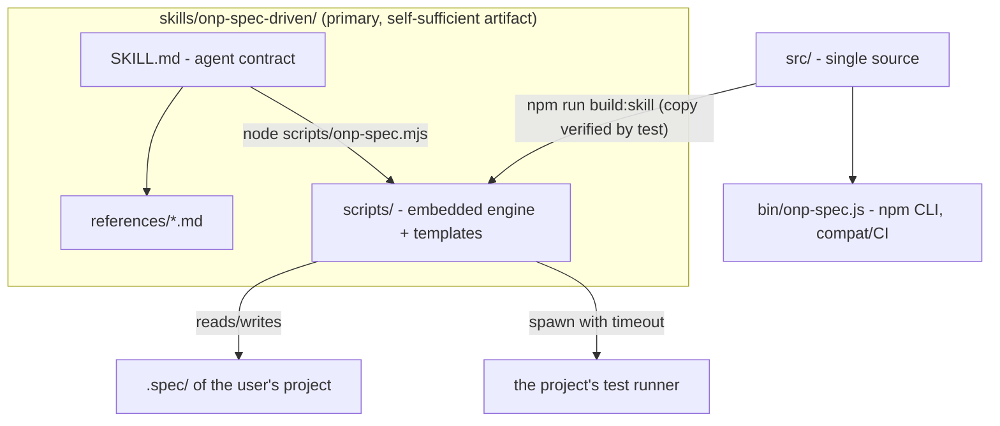

# TDD — onp-spec-driven as a pure skill for the Claude Code harness

| Field         | Value                                                        |
| ------------- | ------------------------------------------------------------ |
| Tech Lead     | @vitormanoel                                                 |
| Team          | Vitor Manoel (O Novo Programador)                            |
| Epic          | Skill-first refactor (post exhaustive testing of 2026-07-17) |
| Status        | Approved (self-approved — solo project)                      |
| Created       | 2026-07-17                                                   |
| Updated       | 2026-07-17                                                   |

## Context

onp-spec-driven is ONP's *spec-anchored* SDD tool: the spec is audited
mechanically against the code (US→AC→T→test traceability, executable DoD,
verifiable constitution). Today it ships as an **npm CLI**
(`@onovoprogramador/onp-spec`) + a thin skill (`skills/onp-spec-driven/`) that
only directs the agent to call the CLI via `npx`.

A battery of ~80 adversarial scenarios (2026-07-17, see
`docs/EXHAUSTIVE-TESTING-FINDINGS.md`) showed that (a) the mechanical engine is
solid at its core — 41/41 own tests, benchmark 100% (9/9), scales to 600 ACs in
52ms — but (b) it has 5 critical holes that allow **gate bypass or a false
verdict**, and (c) the skill, as it stands, is **dead letter without the CLI
installed**: in a sandbox, offline, or in a project that never ran `npm i`, the
agent has no way to execute the contract. The product decision is: **the skill
stops depending on an installed CLI and becomes the primary artifact**,
self-sufficient inside `.claude/skills/`.

**Domain**: AI-assisted development tooling (material for ONP's Spec-Driven
workshop).
**Stakeholders**: Vitor (author/instructor), workshop students (users of the
skill in their own projects), agents (Claude Code/Cursor) that run the flow.

## Problem Definition

### Problems we're solving

- **P1 — Skill inert without the CLI**: SKILL.md instructs `onp-spec ...` /
  `npx ...`. Without the package installed (sandbox, offline, new project), the
  agent improvises or ignores the gate. Impact: the differentiator ("the
  machine proves it") silently turns off.
- **P2 — Gate bypass (findings CR-1..CR-5, critical)**:
  - a `skip`/`todo` test counts as PASS proof (`# SKIP` is `ok` in TAP);
  - `[concluída]` (now `[done]`) with the accent silently becomes `pendente`
    (now `pending`);
  - `audit --json` truncates output >8KB (`process.exit` before the flush) —
    blind CI;
  - a pathological regex in the constitution hangs the audit (ReDoS, 60s+);
  - the base preset requires a `@principle:P-001` test that the flow never
    creates → the gate **never** closes on the happy path and the user learns
    to ignore it.
- **P3 — False positives that erode trust (AL-1..AL-7)**: macOS NFD breaks
  "Então" (now "Then"); a path with a space blows up into `ARQUIVO_INEXISTENTE`
  (now `FILE_MISSING`); indented GWT becomes `AC_INCOMPLETO` (now
  `AC_INCOMPLETE`); a glob typo turns off a principle with no warning; the
  `[OBRIGATORIO]` level disappears; missing Assumptions/Questions sections
  slip by unnoticed (differentiator #3 is not enforced).
- **P4 — Skill with no operational contract for the agent**: no bounded
  correction loop, no atomic commits per task, no context strategy, no
  graceful degradation when `node` doesn't exist.

### Why now?

- The skill is central material for the workshop (edition in progress) —
  students will copy it into real projects as early as August 2026.
- The public benchmark claims "the agent can't declare victory"; CR-1
  (skip = proof) falsifies that claim today.

### Impact of not solving it

- **Business**: the workshop demo breaks on the first `audit --ci` (CR-5) and
  the sales pitch ("100% detection") becomes vulnerable to a trivial
  counter-example.
- **Technical**: every project that installs the skill via `init --agents`
  freezes a copy with the bugs (SK-5 drift).
- **Users**: false `AC_INCOMPLETO` on correct specs (NFD) teaches people to
  distrust the audit — the opposite of the product.

## Scope

### ✅ In scope (V1)

- Self-sufficient skill in `skills/onp-spec-driven/`: rewritten SKILL.md
  (harness-first), references, **embedded mechanical engine** in `scripts/`
  (zero dependencies, runs with the environment's `node` — no npm/npx/install).
- Fixing the 5 critical findings (CR-1..CR-5) and the 7 high findings
  (AL-1..AL-7) in the engine (`src/`), which remains the single source of
  truth.
- Generated sync `src/ → skills/onp-spec-driven/scripts/` with a test that
  fails if they diverge (kills SK-5).
- Agent operational contract in SKILL.md: bounded correction loop (3
  iterations), atomic commit per task, final gate with pasted output, graceful
  degradation without `node`.
- New findings: `GLOB_SEM_ARQUIVOS`, `NIVEL_INVALIDO`, `SECAO_AUSENTE`,
  `FEATURE_DIVERGENTE`, `PROVA_FRACA`, `ID_CURTO`, `TASK_STATUS_INVALIDO`.
- Global ref semantics (IDs are global → cross-feature refs resolve, MD-1).
- Regression tests for every fixed finding (the adversarial battery becomes a
  suite).

### ❌ Out of scope (V1)

- Removing/unpublishing the npm CLI (it keeps existing for pure CI; it becomes
  a consumer of the same `src/`).
- Native Windows support (`\` paths) beyond what already exists.
- New test reporters (keeps tap, vitest-json, jest-json, exitcode).
- Translating the skill to English (done later, see `ARCHITECTURE.md`).
- TLC-style self-evolving lessons/memory (left for V2).

### 🔮 Future (V2+)

- `verificação(auditoria)` (now `verification(gate)`) with semantic queries; watch mode; lessons layer;
  `--agents cursor` installer.

## Technical Solution

### Architecture overview

Dependency inversion: today it's `skill → global CLI`; it becomes
`skill ⊃ engine` (the engine travels inside the skill) and `CLI → same engine`
(compat).

**Components**:

- `SKILL.md` — the agent's contract: phases, auto-sizing, gate, degradation.
  Never mentions npm/npx; resolves `scripts/` relative to the skill's own
  directory.
- `scripts/onp-spec.mjs` + `scripts/lib/` + `scripts/templates/` — generated
  at install time (not committed) copy of `src/` + `templates/` (embedded engine). Zero dependencies; only
  requirement: Node ≥ 18 present in the environment (already a requirement for
  JS projects; for non-JS projects the structural audit keeps working — only
  `verify` depends on the stack's runner).
- `src/` — single source of truth; receives all the fixes.
- `tools/build-skill.mjs` / `src/core/skill-engine.js` — generate `scripts/`
  from `src/`+`templates/`; `test/skill-sync.test.js` checks the generated copy
  mirrors the source and that `init --agents` delivers a runnable skill.

### Central decision: embedded mechanical engine (not "the agent audits by hand")

The alternative "the agent does the audit by reading the files" was
**rejected**: the product exists precisely because the author can't be the
verifier. Proof needs to come from a deterministic process outside the model
(exit code), otherwise we regress to "trust the agent's word". The embedded
engine preserves that without requiring an install: copying the skill folder
is the entire installation.

### Engine fixes (contracts, by finding)

| Finding | Fix (observable contract) |
|---|---|
| CR-1 | TAP/JSON parser recognizes `# SKIP`/`# TODO`/`skipped`/`todo`/`pending` → `skip` verdict. `skip` **never** becomes PASS proof; audit reports `AC_SEM_PROVA` (now `AC_NO_PROOF`) citing the skip. Per-tag rule: any `fail` → fail; else any `pass` → pass; else → skip. |
| CR-2 | Task status normalized (lowercase + no accent): `concluída`/`Concluida` (now `done`/`Done`) ⇒ `concluida` (now `done`). Unknown token in `[...]` ⇒ `TASK_STATUS_INVALIDO` (now `TASK_STATUS_INVALID`, error) — never silently degrade to `pendente` (now `pending`). |
| CR-3 | The `bin` and the embedded entrypoint use `process.exitCode` (never `process.exit()` after writing to stdout) → complete output guaranteed in pipe/CI. |
| CR-4 | Constitution regex verifications run in a subprocess with a timeout (5s per verification); overrun ⇒ `VERIFICACAO_MALFORMADA` (now `CHECK_MALFORMED`, "regex exceeded the time limit") instead of hanging the gate. |
| CR-5 | Base preset: P-001 now uses `verificação(gate)` (now `verification(gate)`) — satisfied by the audit's own mechanism (documented as intrinsic). `scaffold` now also generates a test skeleton for every `verificação(teste)` (now `verification(test)`) with no existing tag ⇒ the happy path closes with exit 0 with no hidden steps. |
| AL-1 | All content read is normalized to `NFC` before parsing (specs, tasks, constitution, annotations). |
| AL-2 | `Arquivos:` (now `Files:`) splits **only on comma** (spaces in paths are valid); backticks are still stripped. |
| AL-3 | GWT clauses and task fields accept indentation and `-`/`*` markers; `**dado**`/`**DADO**` (now `**given**`/`**GIVEN**`) accepted (case-insensitive match). |
| AL-4 | A `verificação(proibido/obrigatório)` (now `verification(forbidden/required)`) glob that matches 0 files ⇒ `GLOB_SEM_ARQUIVOS` (now `GLOB_NO_FILES`, warning). |
| AL-5 | `## P-xxx [LEVEL]` with a level outside MUST/RECOMMENDED/MAY ⇒ `NIVEL_INVALIDO` (now `LEVEL_INVALID`, error) — never ignore. |
| AL-6 | Missing `## Suposições` and `## Perguntas em aberto` (now `## Assumptions` and `## Open questions`) sections ⇒ `SECAO_AUSENTE` (now `SECTION_MISSING`, warning in draft; error with status ≥ `pronta`/`ready`). An explicit "None." satisfies it. |
| AL-7/MD-6 | Proof by the `exitcode` method is only granted to an AC with an annotated test, and every `exitcode` proof generates `PROVA_FRACA` (now `PROOF_WEAK`, warning) — the comment+exitcode bypass is closed. |
| MD-1 | Refs resolve against the **global** set of IDs (IDs are already global); AC coverage likewise. |
| MD-2 | `> feature:` ≠ directory name ⇒ `FEATURE_DIVERGENTE` (now `FEATURE_MISMATCH`, warning). |
| MD-3 | 1–2 digit IDs in headings ⇒ `ID_CURTO` (now `ID_SHORT`, warning, "use 3+ digits"). |
| MD-4 | `verify` with 0 matched tags prints an explicit hint: "no test title contains `@spec:AC-xxx` — the tag goes in the test TITLE". |

### Skill contract (rewritten SKILL.md)

- **Flow**: Specify → (Design) → (Tasks) → Execute → **Audit**, with
  auto-sizing and a safety valve (if listing steps shows >5 steps or
  dependencies, go back and create `tasks.md`).
- **Non-negotiable gate**: the last action of any feature = run the audit in
  CI mode and **paste the output**; exit ≠ 0 ⇒ not done.
- **Bounded loop**: at most 3 fix→re-audit cycles; still failing ⇒ stop and
  present the findings to the user (never loosen a test/principle).
- **Execution**: 1 task = 1 atomic commit; test first (scaffold), then
  implementation until the runner passes.
- **Context**: references loaded on demand per phase; never load two different
  features' specs at the same time.
- **Graceful degradation**: no `node` in the environment ⇒ the skill instructs
  a manual checklist of the same findings, with the result explicitly marked
  as `WEAK PROOF (manual audit)` — never silent.

### Data/format changes

- `.spec/` unchanged (full compat with existing projects).
- `verification/<feature>.json`: the `status` field gains a `skip` value; the
  already-existing `method` field is now required on read (missing ⇒ treated
  as weak).
- Findings catalog: + `GLOB_SEM_ARQUIVOS` (now `GLOB_NO_FILES`), `NIVEL_INVALIDO`
  (now `LEVEL_INVALID`), `SECAO_AUSENTE` (now `SECTION_MISSING`),
  `FEATURE_DIVERGENTE` (now `FEATURE_MISMATCH`), `PROVA_FRACA` (now
  `PROOF_WEAK`), `ID_CURTO` (now `ID_SHORT`), `TASK_STATUS_INVALIDO` (now
  `TASK_STATUS_INVALID`) (documented in ARCHITECTURE.md).

## Risks

| Risk | Impact | Prob. | Mitigation |
|---|---|---|---|
| `scripts/` copy diverges from `src/` (drift) | High | Medium | Generated build + `skill-sync.test.js` that fails the suite on divergence; regeneration is one command |
| Accepting variants (accent/case/indentation) creates new ambiguity | Medium | Medium | Normalization documented in the grammar; regression tests for every accepted and every rejected variant |
| Subprocess with a timeout per regex verification slows the audit down | Low | High | Only `proibido`/`obrigatório` (now `forbidden`/`required`) verifications pay the cost (~50ms each); budget measured in the scale test (600 ACs < 2s) |
| Ref semantics change (local→global) changes the result of existing audits | Medium | Low | Only removes false errors (`REF_QUEBRADA`, now `REF_BROKEN`, on a valid ref); never adds a new error; explicit changelog |
| `verificação(gate)` (now `verification(gate)`) misunderstood (looks "free") | Low | Medium | Preset documentation explains it's satisfied by the audit's mechanism; LGPD keeps real tests |
| Non-JS projects with no `node` lose the mechanical gate | Medium | Low | Explicit graceful degradation (WEAK PROOF) + structural audit stays runnable on any CI with Node |

## Testing Strategy

| Type | Scope | Approach |
|---|---|---|
| Unit | parsers (TAP skip/todo, normalized status, NFC, comma in Arquivos, levels) | `node:test`, cases derived 1:1 from the findings |
| Unit | audit (new findings, global refs, missing section, weak proof) | in-memory fixtures |
| Integration | embedded CLI/entrypoint end-to-end in a sandbox (init→new→scaffold→verify→audit exit 0) | real process, real TAP |
| Adversarial regression | the ~80 lab scenarios become `test/adversarial.test.js` (the 12 that were failing MUST pass) | sandbox per scenario |
| Sync | `scripts/` ≡ build of `src/` | per-file hash |
| Benchmark | 100% (9/9) and clean baseline preserved | `node benchmark/run.js` |

**Critical scenarios**: skip never proves; `[concluída]` (now `[done]`) closes the gate
correctly; a 600-AC JSON stays intact through a pipe; ReDoS doesn't hang; the
happy path (base init → new → scaffold → implement → verify → audit --ci)
exits 0 with no hidden step.

## Implementation Plan

| Phase | Task | Verifiable output |
|---|---|---|
| **F1 — Engine** | Fix CR-1..CR-4, AL-1..AL-7, MD-1..MD-4 in `src/` + regression tests | green `node --test` suite including new cases |
| | Base preset with `verificação(gate)` (now `verification(gate)`) + principle test scaffolding (CR-5) | happy path closes with exit 0 |
| **F2 — Packaging** | `tools/build-skill.mjs` (src+templates → scripts/) + sync test | green `skill-sync.test.js` |
| **F3 — Skill** | Rewrite SKILL.md (harness-first, no npx) + updated references | manual review + smoke test with the agent |
| **F4 — Validation** | Full adversarial battery re-run against the embedded engine | 0 remaining critical/high findings |
| | Benchmark + suite + happy-flow E2E | everything green, output pasted |

Dependencies: F2 depends on F1; F4 closes the loop (same yardstick as the
findings).

## Dependencies

| Dependency | Type | Status | Risk |
|---|---|---|---|
| Node ≥ 18 in the agent's environment | Runtime | Present in Claude Code | Low |
| The user's project's test runner (verify) | External | Varies by stack | Medium — documented degradation |
| No npm package | — | zero-dep maintained | — |

## Open Questions

| # | Question | Current position | Status |
|---|---|---|---|
| 1 | Rename the installed skill to avoid colliding with TLC's `spec-driven` in projects that have both? | Keep `onp-spec-driven` (already a distinct name) and state the boundary in the description | ✅ Resolved |
| 2 | Should the npm CLI be deprecated in the docs? | No — it becomes "CI mode"; the skill is the primary path | ✅ Resolved |
| 3 | Lessons layer (TLC-style) in this version? | V2 — out of scope | ✅ Resolved |
| 4 | Accept 1–2 digit IDs instead of just warning? | Just a warning (`ID_CURTO`) — changing the grammar breaks visual uniqueness | ✅ Resolved |

## Rollback Plan

- The refactor is additive and versioned in git in the `onp-spec-driven` repo;
  rollback = `git revert` of the range (no data migration — users' `.spec/`
  doesn't change format).
- The published npm CLI stays functional through the whole transition; if the
  embedded skill shows a regression in the field, the old (CLI-first) SKILL.md
  comes back via revert while the engine is fixed.
- Rollback trigger: any critical adversarial-battery scenario (CR-*)
  regressing, or benchmark < 100%.
